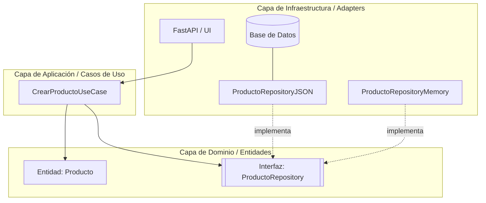

# Sistema de Inventario - Clean Architecture

## Parte 1. Identificar el núcleo

**Regla 1: El precio de venta de un producto debe ser mayor a cero.**
*   **Por qué es relg de negocio:** Es una política comercial para evitar pérdidas financieras o reglos accidentales en el punto de venta. No es un detalle de infraestructura porque esta restricción debe cumplirse independientemente del motor de bse de datos que se use y sin importar si la interfaz es una p´gina web, una aplicación móvil o una terminal de comandos. La infraestructura solo obedece esta regla lógica.
* **Entidades involucradas:** 'Producto' (tributos: 'id', 'nombre', 'precio_venta').

**Regla 2: El código de barras debe de ser único en el catálogo.**
* **Por qué es regla de negocio:** Garantiza la integridad del cobro en caja evitando colisiones al momento de escanear artículos físicos. No es un detalle de infraestructura porque, unque las bases de datos relacionales puedan forzar la unicidad con un "UNIQUE constraint", la necesidad de que el código sea único nace de la logística del negocio real, no de una limitación técnica de almacenamiento. Si cambiamos a un archivo JSON sin restricciones de base de datos, la regla debe seguir existiendo en el código.
* **Entidades involucradas:** 'Producto' (atributos: 'codigo_barras').

**Regla 3: No se puede realziar una venta si el stock disponible es menor a la cantidad solicitada.**
* **Por qué es regla de negocio:** Responde a la limitación física del mundo real (es imposible entregar físicamente algo que no tienes en el almacén) y evita descuadres contables y problemas de satisfacción al cliente. No es un detalle de infraestrctura porque la validación requiere comparar el inventario actual con el solicitado antes de intentar descontarlo; la responsabilidad no recae en la base de datos, sino en la lógica central de la aplicación que debe aprobar o denegar la transacción.

##  Parte 2. Diseño por capas
**Diseño de la Regla 1 (Precio mayor a 0):**
* **Entity:** 'Producto'. Valida en su constructor que el 'precio_venta > 0'.
* **Use case:** 'CrearProductoUseCase'. *Entrada:* Datos del producto. *Pasos:* Valida regla, verifica dulicados, llama al repositorio para guardar. *Salida:* Producto creado o error.
* **RepositoryInterface:** 'ProductoRepository' (con el método 'guardar').
* **Adapter:** 'ProductoRepositoryPostgres'.

### Diagrama de Capas

---

## Parte 5. Cierre

**¿Qué parte de su proyecto les costó más ubicar en una capa?**
Lo más complejo fue separar los schemas de validación web de la Entidad de Dominio. Al principio se queria usar el mismo modelo para recibir los datos de internet, validar la regla de negocio y mapear a la base de datos. 

**¿Qué ganan con poder cambiar la infraestructura sin tocar el núcleo?**
Se gana adapatabilidad y seguridad. Como se demostró en la Parte 4, se logró cambiar el sistema de alamcenamiento de un diccionario en memorio a un archivo JSON sin modificar ni una sola línea de la Entidad o del Caso de uso. 